# Sparko

Sparko is a browser video editor for interactive stories. Cut your footage, generate new scenes that match the clips around them, and connect everything into a story that can loop or branch on the viewer's answers.

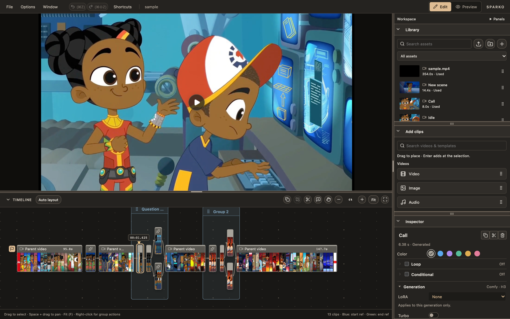

## What it does

- **Timeline of connected clips.** Clips are filmstrips joined by lines. The lines decide what plays next, so a story can run straight through, repeat a clip, or branch on a choice.
- **Generated video.** A new scene takes the end of the clip before it and the start of the clip after it as references, so it joins both.
- **Generated images and audio.** Make pictures, dialogue, music and sound effects on the same timeline. Characters keep a look and a voice across clips.
- **Preview.** Watch the project as a viewer would, with scenes, loops and choices marked on the seek bar.
- **Portable projects.** A project saves as one `.sparko` file that contains all its media.

## Run it

Requires Node.js 24 and a current Chrome or Edge.

```sh
git lfs install
git lfs pull
npm install
cp .env.example .env   # then add your API keys
npm run dev
```

Open **http://127.0.0.1:3000** and choose **Sample project** to explore a finished edit, or **New project** to start your own.

On Windows, `powershell -ExecutionPolicy Bypass -File .\Start-Sparko.ps1` installs dependencies and starts the server.

Each key in `.env` turns on one part of the app. Editing and playback work without any of them.

| Key | Used for |
| --- | --- |
| `COMFY_CLOUD_API_KEY` | Video generation |
| `FAL_KEY` | Image generation |
| `ELEVENLABS_API_KEY` | Dialogue, music, sound effects and character voices |
| `OPENAI_API_KEY` | **Enhance prompt** and **Edit with AI** |
| `GEMINI_KEY` | Gemini analysis and voice features |

More in [Setup](docs/setup.md).

## Tutorial: add a new scene to a video

The same walkthrough is built into the app under **Window → Help & tutorial**, along with pages on the timeline, generation, images and audio, templates, and saving.

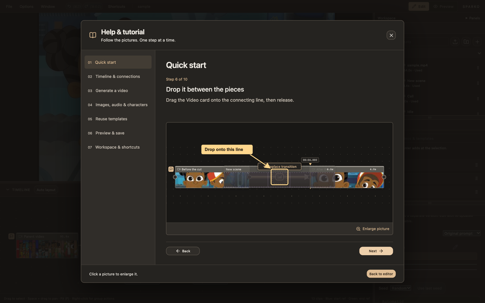

**1. Import your video.** Choose **New project**. Drop a video on the timeline, or click **Import videos or images**.

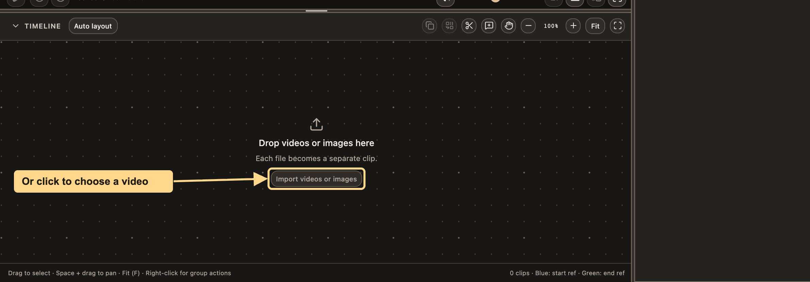

**2. Pick the moment.** Click inside your clip. The vertical line, called the playhead, moves to that moment.

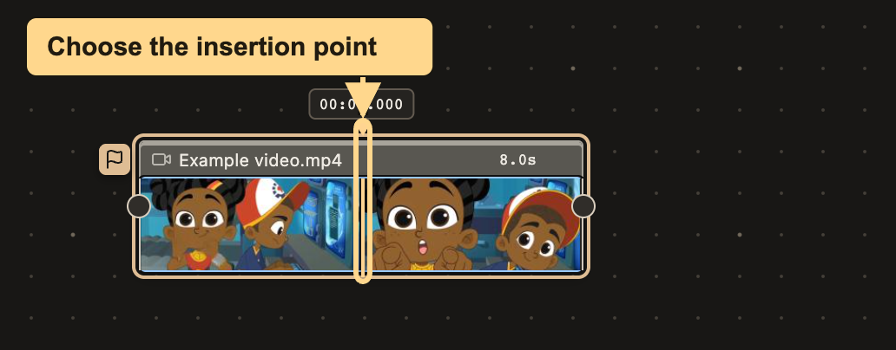

**3. Cut the video into two pieces.** Right-click the clip and choose **Cut at playhead**.

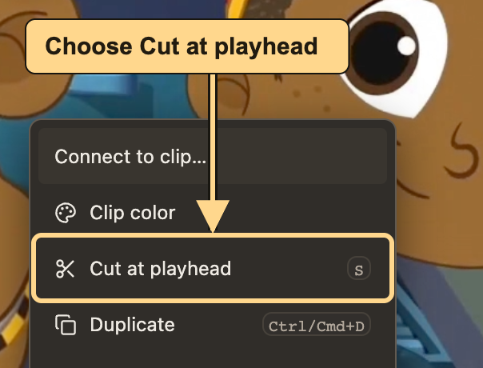

**4. Drop a Video card between the pieces.** In **Add clips**, drag the **Video** card onto the line that connects the two pieces.

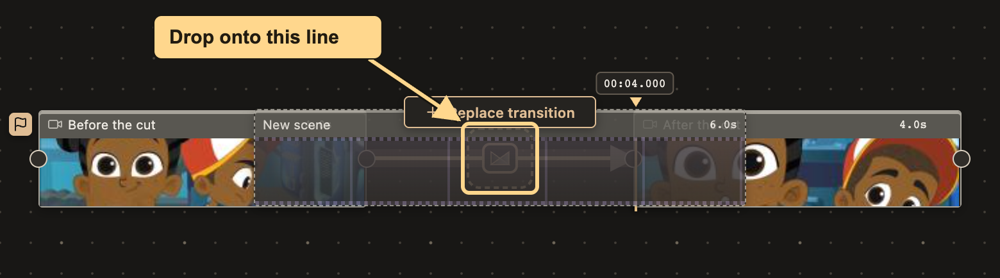

The new scene now sits between the two pieces. It stays empty until you generate it.

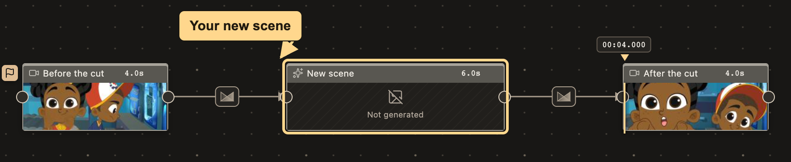

**5. Describe the scene.** Select the new clip. In **Inspector**, write what should happen under **Original prompt**.

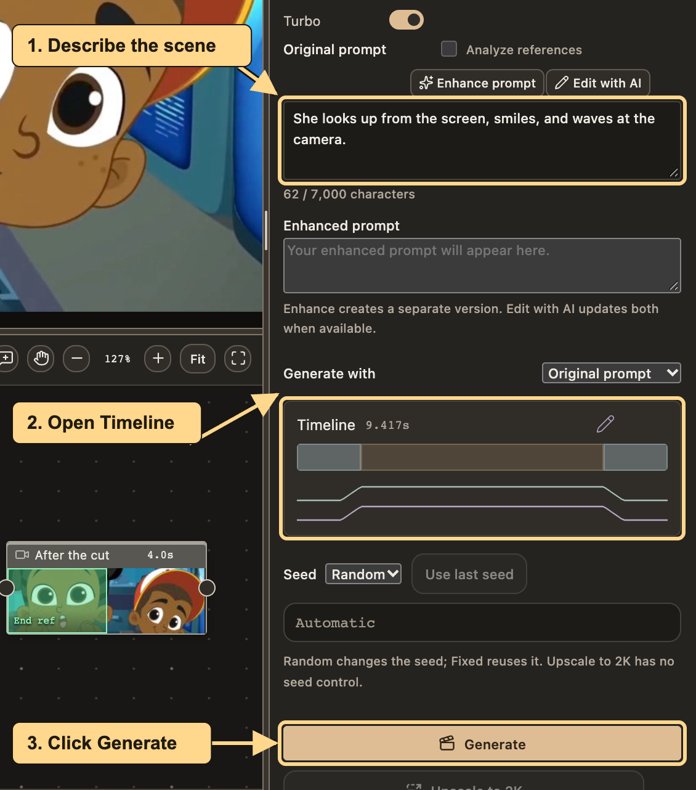

**6. Check what it matches.** Click **Timeline** in Inspector. Keep **Start video** and **End video** on so the scene begins like the first piece and ends like the second, and set **Duration**.

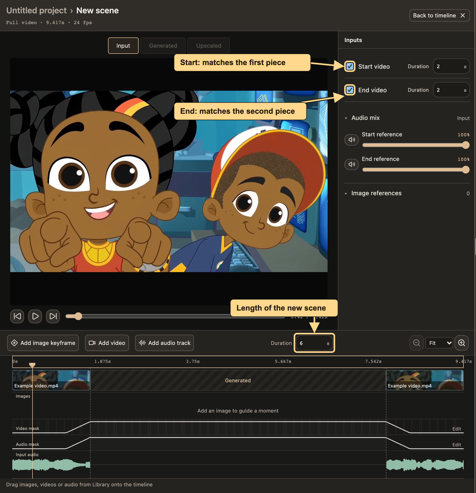

**7. Generate.** Click **Generate**. The clip shows its progress, then plays the new scene in place.

**8. Watch and save.** Click **Preview** to watch it as viewers will, then choose **File → Save project**.

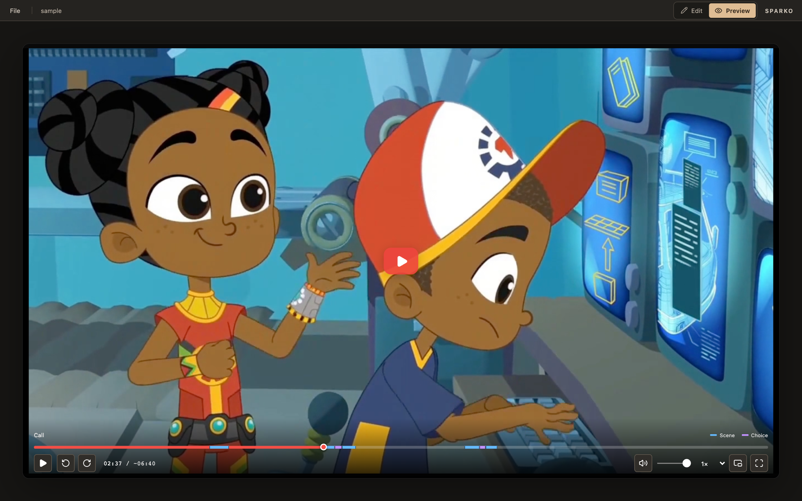

## Going further

A finished video opens in the generation timeline, where you can compare the input with the result, guide a moment with an image, or add audio tracks.

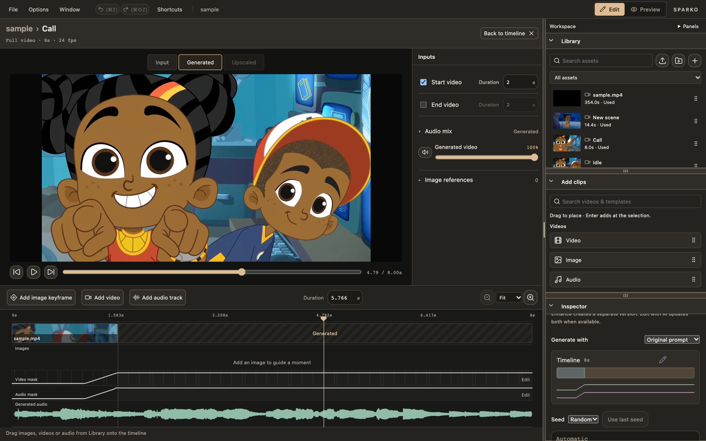

| Guide | What it covers |
| --- | --- |
| [Editing](docs/editing.md) | Timeline, Library, connections, loops and choices, comments, groups, templates, shortcuts |
| [Generation](docs/generation.md) | Video, image and audio generation, references, masks, prompts, upscaling, Comfy Cloud |
| [Projects](docs/projects.md) | Browser storage and `.sparko` project files |
| [Setup](docs/setup.md) | Keys, model IDs, pulling environment variables from Vercel |
| [Deployment](docs/deployment.md) | Hosting on Vercel |
| [Architecture](docs/architecture.md) | How the code is organized |
| [Internal APIs](docs/apis.md) | Spoken-answer and MP4 export APIs that have no UI yet |
| [Testing and CI](docs/testing.md) | Running the test suites and how CI is set up |
| [Streaming architecture](docs/streaming-architecture/README.md) | Proposal for a subscription streaming service |

## Development

```sh
npm run typecheck
npm test
npm run build
npm run test:e2e
```

The tutorial pictures and the screenshots on this page come from the running app. With the dev server running, regenerate them after a UI change:

```sh
node --import tsx scripts/capture-tutorial.ts
```
