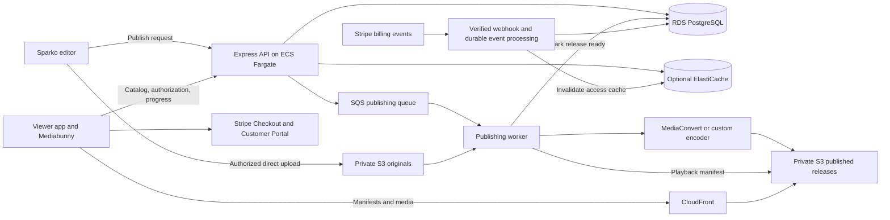

# Sparko streaming architecture

Design snapshot: **2026-10-30**.

This document records the proposed architecture for a subscription app that streams published Sparko projects with choices, loops, and crossfades. It is a design reference for future implementation. The AWS resources, publishing service, subscription integration, and production streaming controls described here have not been implemented or provisioned by this design work.

The existing editor and Mediabunny playback engine provide much of the client foundation. Keep that engine and extend it for remote assets, adaptive quality, and network-aware buffering.

## Scope and assumptions

- Target audience: **1 million daily users**, with **10,000 simultaneous active streams** as the initial capacity target.
- Initial product: browser-based playback of previously generated and published content. Live broadcasting and generating unique video for each viewer are separate workloads.
- Preserve the Sparko graph rather than rendering every possible story path into a separate movie.
- AWS hosts the application, databases, publishing jobs, storage, and video delivery. Stripe provides payments. Existing AI generation providers remain separate dependencies and cost centers.
- Begin with one primary application region and a global CDN. Availability, regional recovery, and international delivery requirements need to be set before production deployment.
- Capacity figures are design estimates, not measured production guarantees.
- This is a commercial service operated by a business entity. Vendor ownership, billing, production access, and recovery must belong to that entity from the outset.

Daily users and concurrent streams are different measures. If all one million users watch every day and 10,000 is the maximum concurrency, average viewing cannot exceed 14.4 minutes per user per day even with that peak sustained all day. Normal traffic variation lowers that bound. Longer viewing sessions require a higher concurrency target.

## Business ownership and accounts to set up

The following is the proposed account inventory; creation and verification are still to be confirmed. Use the company's actual legal name, registration country, address, billing details, and authorized representatives. The entity's jurisdiction has not been specified. Select service plans for the required controls, capacity, and support; business ownership does not automatically require every vendor's Enterprise tier.

| Account or tenant | Business setup | Purpose |
| --- | --- | --- |
| Domain registrar and DNS | Company-owned registration, renewal billing, named administrators, and recovery contacts. DNS can use Route 53 in AWS. | Product hostname, email domain, and service verification. |
| Company email and workforce identity | Company-managed tenant with individual staff identities and monitored billing, security, operations, and support addresses. | Staff access, vendor notices, customer support, and account recovery. Keep recovery usable during an application outage. |
| AWS organization | Company-owned management/billing account on the Paid plan, with separate workload accounts below. Use the advanced signup path for this architecture's access and infrastructure controls. | Application hosting, storage, streaming, authentication, email delivery, and operations. See [AWS signup options](https://aws.amazon.com/resources/create-account/). |
| Stripe merchant account | Register the actual business entity and activate live payments; configure Billing, Checkout, and Customer Portal in that account. | Collect subscriptions and pay proceeds to the business bank account. |
| Business banking and payment method | Company payout account with supported country/currency details, plus a company-controlled method for paying vendors. | Receive Stripe payouts and pay AWS and other operating bills. Confirm [Stripe bank account requirements](https://docs.stripe.com/payouts). |
| GitHub organization | Company-owned organization holding the repository and CI configuration; invite individual users and assign team roles. Evaluate Team or Enterprise against the controls needed. | Company ownership of source and deployment workflows. GitHub users sign in individually to the [organization](https://docs.github.com/en/organizations/collaborating-with-groups-in-organizations/about-organizations). |
| Generation providers, if retained | Company-owned provider workspaces/projects, billing, access roles, and usage budgets. | Existing AI generation remains a separate vendor dependency. |

### AWS account structure and access

Recommended account boundaries for the stated production target:

| AWS account | Responsibility |
| --- | --- |
| Management / billing | Organization administration and consolidated billing. Keep application workloads elsewhere. |
| Production | Live application, customer data, published media, and production service configuration. |
| Nonproduction | Development and staging, with separate data, secrets, media, and Stripe sandbox integration. Split development and staging later if needed. |
| Log archive | Central audit records with retention and access controlled separately from application operators. |
| Security / audit | Security administration and investigation across member accounts. |

This is the recommended deployment structure, not a vendor requirement to open five accounts before a local prototype. Establish these boundaries before production launch. AWS provides [multi-account guidance](https://docs.aws.amazon.com/organizations/latest/userguide/orgs_best-practices.html).

- Give each AWS account a unique company-controlled root email address and maintained recovery contact. Protect the management account's root credentials with MFA and reserve them for root-only tasks. Enable centralized root access management so member accounts can operate without standing root credentials. See [AWS root access guidance](https://docs.aws.amazon.com/IAM/latest/UserGuide/id_root-user.html).
- Use an organization instance of [IAM Identity Center](https://docs.aws.amazon.com/singlesignon/latest/userguide/what-is.html) for individual workforce access. Separate engineering, production operations, security, and finance permissions. Viewer login through Cognito is a different identity system.
- Use workload roles for services and restricted [GitHub Actions OIDC roles](https://docs.github.com/en/actions/how-tos/secure-your-work/security-harden-deployments/oidc-in-aws) for deployment. Scope trust to the intended repository/environment; keep production and staging credentials separate.

S3, CloudFront, ECS, RDS, ElastiCache, Cognito, SES, and ECR are services configured within AWS accounts. They do not each need a separate vendor account. Paid usage, AWS support coverage, and any negotiated CDN agreement are separate purchasing decisions.

### Stripe activation and team access

Complete [Stripe business verification](https://docs.stripe.com/get-started/account/set-up) with the entity's details and representative/ownership information requested during onboarding. Configure the business website, support contacts, and recognizable statement descriptor. Confirm the registration country before activating live services: Stripe says the business origin country cannot then be changed on that account.

Use a Stripe sandbox for development and staging, with separate keys, webhook secrets, and price IDs from live mode. Invite staff through [Stripe team roles](https://docs.stripe.com/get-started/account/teams), granting finance, support, and engineering only the permissions their work needs. Store server credentials in the appropriate environment's secrets store.

This design assumes the company sells its own subscriptions. A standard merchant account is sufficient for that payment model. Revisit [Stripe Connect](https://docs.stripe.com/connect) if the product later routes payments to independent creators or other sellers.

### Setup order and operating ownership

1. Confirm the entity, registration country, domain ownership, business banking, and authorized account owners. Establish company email and recovery first.
2. Create or confirm AWS, GitHub, and Stripe ownership; configure MFA, individual roles, and a second authorized administrator/recovery custodian. Record account IDs, billing owners, renewal dates, and recovery procedures in an internal inventory. Keep secrets and verification documents out of this repository.
3. Configure AWS environments, audit logging, cost allocation, budget alerts, and billing/security/operations contacts. Assign someone to respond to alerts and production incidents.
4. Configure transactional email for signup and account recovery. If using SES, verify the sending domain, configure email authentication, and request [production access in each sending region](https://docs.aws.amazon.com/ses/latest/dg/request-production-access.html). Validate sending quotas before launch; SES production access is separate from having an AWS Paid plan.
5. Complete Stripe live activation and payout setup before accepting paying customers. Keep the business's refund, cancellation, and customer-support policies consistent with the subscription implementation.
6. Before production, select 24/7 AWS technical support appropriate to the business's response requirements, confirm service quotas, and obtain a CDN quote at the projected volume. As of this snapshot, assess **Business Support+** or **Enterprise Support** using the [current AWS support plans](https://aws.amazon.com/premiumsupport/). Assign an internal incident owner; vendor support does not operate the application for us.

Budget for support, company email, domain renewal, source-control seats, and any additional operations tools alongside the hosting estimates below. Account setup is an early implementation milestone; this document has not opened accounts or enrolled in paid services.

## System layout



| Responsibility | Proposed service | Notes |
| --- | --- | --- |
| Original media and private project snapshots | S3 | Preserve source files separately from playback outputs. |
| HLS playlists, segments, captions, thumbnails, story manifests | S3 + CloudFront | Media requests go directly to the CDN. |
| Encoding quality variants and packaging HLS | MediaConvert or a custom worker | Choose one initial publishing path; evaluate output against Sparko's timing and transition requirements. |
| API and custom publishing/billing workers | ECS Fargate | One application codebase can have separate API and worker processes. Scale them independently. |
| Projects, releases, catalog, access records, viewing progress | RDS PostgreSQL | Durable application source of truth; use connection pooling and appropriate indexes. |
| Metadata cache, temporary sessions, optional stream limits | ElastiCache for Valkey/Redis OSS | Optional initially. Do not make it the only copy of published projects or viewing history. |
| Background work | SQS | Retry-safe jobs, bounded retries, and dead-letter handling. |
| Signup and login | Cognito, subject to feature/cost review | Authentication is separate from the application's paid-access decision. |
| Recurring billing | Stripe Billing + Checkout + Customer Portal | Stripe is the billing authority; the app maintains a synchronized access record. |
| Metrics, logs, alarms | CloudWatch | Include playback telemetry from the client, not just server health. |

AWS documents the standard [S3, encoder, and CloudFront VOD architecture](https://docs.aws.amazon.com/AmazonCloudFront/latest/DeveloperGuide/on-demand-video.html). Once encoded, HLS delivery consists of HTTPS requests for playlists and media files; it does not require a dedicated, continuously running video streaming server.

## Existing playback capability: verified findings

The inspected dependency was **Mediabunny 1.61.5**. Its HLS support is already compatible with Sparko's input and decoding interfaces.

| Existing code | Capability |
| --- | --- |
| [`openInput()`](../../src/media/media.ts) | Uses `UrlSource` and `ALL_FORMATS`, which already support remote HLS input. |
| [`FrameDecoder`](../../src/features/player/FrameDecoder.ts) | Reads video and audio tracks through `VideoSampleSink` and `AudioBufferSink`. |
| [`CanvasMediaDecks`](../../src/features/player/CanvasMediaDecks.ts) | Manages decoded media decks and feeds the compositor and audio clock. |
| [`CanvasFlowPlayback`](../../src/features/call-response/CanvasFlowPlayback.ts) | Implements graph playback, transitions, and preparation of the predicted next scene. |
| [`StoryGraph`](../../src/features/story-flow/model.ts) | Represents scenes, choices, loops, trims, and connection-specific fades. |
| [`AssetLibrary`](../../src/features/project/assets.ts) | Currently resolves local IndexedDB Blobs into object URLs; requires a published-asset equivalent. |

A local research probe packaged the existing four-second, 25 fps video fixture into HLS with two fragmented MP4 segments. Mediabunny read all **100 video packets over HTTP**. Sparko's unchanged `FrameDecoder`, running in Chrome, decoded frames across both segments and sought back to the beginning.

That probe was video-only, local, and short. It did not validate audio continuity, complete graph playback over HLS, mobile devices, adaptive switching, adverse networks, or large-scale delivery. It was an ad hoc probe, not a committed regression test.

Mediabunny exposes HLS through its normal track, packet, and sample interfaces and handles playlist parsing and lazy segment loading. It also supports HLS output. See [Reading HLS](https://mediabunny.dev/guide/reading-hls), [Media sinks](https://mediabunny.dev/guide/media-sinks), and [Writing HLS](https://mediabunny.dev/guide/writing-hls).

```text
S3 / CloudFront
  -> UrlSource
  -> Mediabunny HLS demuxing
  -> video/audio sample sinks
  -> existing GPU compositor and audio clock
```

Packet access does not remove the need to decode video for crossfades. Sparko already has that compositor. Keep it rather than treating arbitrary compressed packets as directly spliceable video; decoder configuration, keyframes, timestamps, and audio boundaries still matter.

## Data ownership and release format

Keep these three concepts separate:

| Data | Owner | Delivery/use |
| --- | --- | --- |
| Media timeline | Published HLS playlists and segments | Encoded samples, timing, and available quality variants. |
| Story graph | Immutable, versioned playback manifest in S3 | Entry scene, scene media, playable bounds, choices, loops, edges, transitions, and caption references. |
| Viewer state | Client session with durable Postgres checkpoints | Release ID, current scene, scene-local position, loop iteration, and choice/path history. |

Postgres also stores catalog metadata, release status, the current published release pointer, ownership/access rules, Stripe customer mapping, and subscription access records. Redis may cache these records, but a cache loss must not destroy them.

Proposed release paths:

```text
media/projects/{projectId}/releases/{releaseId}/
  story.json
  assets/{assetId}/master.m3u8
  assets/{assetId}/...
  captions/...
  thumbnails/...
```

The playback manifest should have its own schema version and contain only viewer-facing data. Do not serve the complete editable `.sparko` archive as the playback API: it includes originals, generation prompts, job information, and other editor data unnecessary for viewing.

Use stable asset IDs with a resolver that selects local Blobs in the editor or CDN URLs in the published viewer. Reuse encodes by content/settings hash where possible. Initially, keeping authorized media under a release prefix simplifies access scoping; sharing physical objects across releases is a later storage optimization that needs explicit authorization design.

Preserve the distinction between the existing **24 fps edit clock** and native media timestamps/frame cadence. Publishing must preserve playable-body bounds and the reference footage required by transitions. Do not assume that trimming every asset to its visible body preserves crossfades.

## Publishing workflow

1. Create a release record and authorized upload destinations. Upload media directly to private S3 rather than relaying large files through the API.
2. Verify uploaded objects and validate the graph, media references, playable ranges, and availability of all required generated outputs. Loops are valid graph behavior; dangling destinations or missing required media are errors.
3. Enqueue an idempotent publishing job tied to the project snapshot and encoding settings.
4. Produce the selected bitrate ladder, HLS packaging, captions, and thumbnails. Align rendition timing and switching boundaries; preserve transition handles and test audio boundaries.
5. Compile the playback manifest from the validated snapshot. Shared scenes should reuse media; avoid expanding every branch combination into a full-length movie.
6. Validate the completed outputs before marking the release ready. Atomically update the current-release pointer in Postgres only after its assets are available.
7. Keep viewers pinned to the release they started. Retain older releases while sessions or rollback policy require them; garbage-collect unreferenced outputs later.

Publishing can use MediaConvert for conventional encoding/packaging, or a custom Mediabunny/FFmpeg worker where Sparko-specific processing is needed. Mediabunny's HLS writer makes a custom path possible, but does not establish the throughput or reliability of a future publishing service.

## Playback and access workflow

1. The viewer requests playback from the API with a project/release identifier.
2. The API verifies identity, content access, subscription entitlement, and any configured concurrent-stream rule.
3. It returns the published manifest location, saved progress, and short-lived CDN authorization.
4. The viewer loads the story manifest and requests media directly from CloudFront. Ordinary graph decisions execute locally; no API call is needed for each frame, segment, or branch.
5. Save checkpoints periodically and at meaningful events such as choices and pauses. Include the release ID and a session/sequence identifier so delayed writes do not overwrite newer progress. Define how multiple devices compete for the resume position.
6. Refresh playback authorization before expiry while the account remains entitled.

Use private S3 origins with [CloudFront origin access control](https://docs.aws.amazon.com/AmazonCloudFront/latest/DeveloperGuide/private-content-restricting-access-to-s3.html). [Signed cookies](https://docs.aws.amazon.com/AmazonCloudFront/latest/DeveloperGuide/private-content-signed-cookies.html) can authorize a collection of HLS files while retaining shared media URLs.

A simple web deployment can use one application hostname with CloudFront routing `/api/*` to the API without caching personalized responses and `/media/*` to private S3. Set authorization cookies securely on the appropriate host/path. If media uses another origin, explicitly configure cookie credentials and CORS for Mediabunny's fetches. Do not broaden media authorization merely to work around cookie configuration.

Keep per-viewer identifiers out of media cache keys when they do not change the bytes. CDN authorization and shared caching should coexist. See [CloudFront cache-key guidance](https://docs.aws.amazon.com/AmazonCloudFront/latest/DeveloperGuide/understanding-the-cache-key.html).

## Stripe subscription design

Use [Stripe Checkout](https://docs.stripe.com/payments/checkout/build-subscriptions) for subscription signup and the [Customer Portal](https://docs.stripe.com/customer-management) for billing details, invoices, plan changes, and cancellation.

- Create Checkout and portal sessions server-side for the authenticated account. Bind the Stripe customer to the internal user ID and allow only configured plans/prices.
- Verify webhook signatures against the raw request body. Durably record or enqueue accepted events before acknowledging them.
- Process events idempotently, deduplicate event IDs, and tolerate out-of-order delivery. Retrieve current Stripe state where necessary, prevent concurrent workers from overwriting newer subscription state, and periodically reconcile local records.
- Synchronize a local entitlement record containing plan, access status, and access expiry. Grant paid access from confirmed billing/subscription state or a permitted trial, not merely from the browser's success redirect.
- Apply renewal, cancellation, failed-payment, refund, and dispute policies consistently. Cancellation at period end should preserve access through the allowed paid period. Decide the failed-payment grace policy explicitly.
- Invalidate entitlement caches when state changes. Playback authorization reads local access state; it should not call Stripe for each segment or routine refresh.

Stripe documents [subscription events](https://docs.stripe.com/billing/subscriptions/webhooks) and [webhook ordering, retries, and duplicate handling](https://docs.stripe.com/webhooks). Store only the payment/customer references needed by the app; use Stripe's hosted payment collection.

A candidate access policy is **15-minute CDN grants**, refreshed around every 10 minutes and capped by known access expiry. Revocation becomes effective for new media requests after outstanding grants expire, plus any explicitly allowed cache delay. Already downloaded media can continue playing. Immediate per-viewer revocation would require an additional authorization mechanism and should be justified by a product requirement.

Optional plan limits such as two simultaneous streams need short-lived server-side session leases and heartbeats. Signed cookies alone do not enforce a strict device or concurrency limit.

## Limitations and improvements

| Limitation or uncertainty | Improvement | Evidence needed |
| --- | --- | --- |
| No adaptive bitrate controller in Sparko | Select quality from network and decode performance; switch at compatible boundaries and keep audio paired correctly. | Throttling and recovery tests without repeated quality oscillation or timeline jumps. |
| `FrameDecoder` selects tracks once | Add controlled track replacement/preparation while preserving the playback clock. Mediabunny exposes variants as tracks. | Seamless changes across the actual published ladder. |
| Small decoded-frame queues are not a complete network buffering policy | Keep decoded memory bounded and separately manage compressed bytes/packets ahead of playback. | Stable memory and acceptable rebuffering on long sessions. |
| Current preload prepares the predicted next scene | Add bounded, prioritized preparation for candidate branches and cancel unnecessary work. | Late-choice tests plus measurements of unused downloaded bytes. |
| Local asset storage dominates the editor flow | Add the remote asset resolver and immutable published manifest. | Viewer can start without downloading a project archive or full source asset. |
| HLS packet/frame smoke test covered only four seconds without audio | Test full graphs, audio transitions, loops, seeking, captions, interruptions, and reconnects. | Repeatable browser integration tests using remote HLS fixtures. |
| Browser codec/GPU behavior varies | Define a supported device matrix and test mobile Safari, Android, and desktop browsers on real devices. | Startup, dropped-frame, battery/memory, fullscreen, and picture-in-picture results. |
| Startup inspection may fetch more media than needed | Use published metadata where trustworthy; profile `computeDuration()` and track probing against HLS variants. | Startup request/byte traces. |
| Cache lifetimes and separate decoder inputs may cause repeated reads | Measure actual fetch behavior and introduce shared compressed-media caching only where beneficial. | Loop and branch traces showing reuse without unbounded memory. |
| Billing events and playback grants are eventually consistent | Durable event processing, reconciliation, bounded cache TTLs, and explicit expiry policies. | Duplicate, delayed, reordered, and failed-event scenarios. |
| Production capacity and recovery are unmeasured | Load-test API bursts/checkpoints; configure replicas, database recovery, queues, alarms, and CDN quotas. | Load-test results and restore/recovery exercises. |

The principal remaining playback engineering work is **network-aware quality selection and buffering around branches**. HLS parsing and packet access are already available. Mediabunny also supplies byte caching, prefetching, and request retry behavior; do not mistake the small decoded queue for the absence of those capabilities.

At 1080p, the current decoded-frame limit calculation permits approximately four frames. Keep that memory constraint separate from the amount of compressed media fetched ahead. Test several simultaneous decoding decks on target hardware before choosing a branch-prefetch budget.

For captions, retain an explicit external WebVTT path initially: Mediabunny's current [HLS reading documentation](https://mediabunny.dev/guide/reading-hls) does not support extracting HLS subtitle tracks. If commercial DRM becomes a requirement, evaluate a compatible protected playback path separately; access-controlled CDN delivery alone is not DRM.

Loading and publishing feedback must follow [AGENTS.md](../../AGENTS.md): progress belongs inside the triggering control, reserved space, or an accessible overlay. Verify idle, loading, success, and failure layouts at desktop and narrow widths without shifting controls.

## Capacity model

Illustrative load at 10,000 active streams:

| Operation | Assumption | Approximate load |
| --- | --- | --- |
| Media delivery | 3-5 Mbps per viewer | 30-50 Gbps through CloudFront |
| Video segment requests | Four-second segments | 2,500 requests/second, plus audio, playlists, and retries |
| Progress checkpoints | Every 30 seconds | 333 updates/second, plus event-driven saves |
| Playback authorization refresh | Every 10 minutes | 17 requests/second, plus playback starts |

Login and playback-start bursts, catalog reads, billing events, and telemetry are additional workloads. Stagger periodic refresh/checkpoint requests to avoid synchronized spikes. Measure write amplification and history retention before sizing Postgres; one indexed current-progress row per user/project is different from retaining every heartbeat indefinitely.

The API can scale horizontally while media delivery bypasses it. Publishing scales with new content rather than viewer count. At 100,000 simultaneous streams, the same bitrate assumptions imply 300-500 Gbps and require further CDN capacity planning. AWS currently lists default per-distribution quotas of 150 Gbps and 250,000 requests/second where applicable; these quotas do not apply to flat-rate plans. Check actual account limits and arrange increases before launch events. See [CloudFront quotas](https://docs.aws.amazon.com/AmazonCloudFront/latest/DeveloperGuide/cloudfront-limits.html).

Track startup latency, rebuffer time, branch-transition stalls, audio/video drift, dropped frames, downloaded-but-unwatched bytes, CDN hit ratio, authorization failures, API latency, database load, queue age, and billing synchronization lag. Set measurable acceptance targets before production rollout.

## Cost model and dated pricing assumptions

Prices below are a **2026-10-30 reference**, in **USD**, not an AWS quote. Recheck rates, geography, account eligibility, and negotiated terms before budgeting.

Traffic estimates assume every daily viewer watches 10 minutes per day at an average total delivered media bitrate of 3-5 Mbps for 30 days. Transfer volumes use decimal TB/PB; the rate calculation converts bytes to GiB and applies 1,024-based tier boundaries.

| Daily viewers | Monthly media transfer | Estimated North American CloudFront pay-as-you-go transfer charge |
| --- | --- | --- |
| 10,000 | 67.5-112.5 TB | $4,800-$7,300 |
| 100,000 | 0.675-1.125 PB | $28,000-$41,000 |
| 1,000,000 | 6.75-11.25 PB | $166,000-$250,000 |

Calculated from [CloudFront public volume pricing](https://aws.amazon.com/cloudfront/pricing/pay-as-you-go/), including its first 1 TB free allowance. These are transfer-only estimates: exclude requests, extra branch prefetching, retransfers, storage, encoding, application services, authentication, Stripe, taxes, and content generation. Rates vary by delivery geography. CDN cache hits still incur delivery charges.

Evaluate flat-rate or negotiated pricing rather than treating that table as the recommended purchasing arrangement. Published Premium allowances include **125 TB for $2,250/month** and **600 TB for $10,000/month**; usage above 600 TB/month is directed to custom pricing. Sustained excess usage can cause delivery adjustments. See [CloudFront plan allowances](https://docs.aws.amazon.com/AmazonCloudFront/latest/DeveloperGuide/flat-rate-pricing-plan.html).

Other cost examples and drivers:

| Item | Reference or budgeting implication |
| --- | --- |
| API compute | Four continuously running Linux/x86 Fargate tasks, each with 2 vCPUs and 4 GiB RAM, cost about **$285 per 30 days** at the published Northern Virginia rates. This excludes networking, load balancing, logs, and databases, and is not a measured capacity claim. |
| Authentication | At **one million monthly active direct/social users**, Cognito's published rates imply about **$4,635/month for Lite** or **$14,850/month for Essentials**, excluding messaging and optional features. One million DAU may imply many more MAU. |
| Database and cache | Depend on query/write rates, indexes, retained history, redundancy, backups, and recovery targets. No complete fleet estimate has been established. |
| Storage | Depends on originals, retained release versions, all quality renditions, and unused/generated assets. |
| Publishing | Depends on new output minutes, resolutions/codecs, and whether custom processing is required. |
| Observability and network services | Include load balancing, NAT where used, request charges, logs, and metrics. Avoid sending the media path through API tasks or NAT gateways. |
| Business operations | Budget separately for AWS support, company email/identity, domain renewal, source-control seats, and any additional operations tools. These are not included in the media-transfer or compute examples. |
| Stripe and generation | Separate from hosting; payment/Billing fees and AI generation usage need their own model. |

Sources: [Fargate pricing](https://aws.amazon.com/fargate/pricing/), [Cognito pricing](https://aws.amazon.com/cognito/pricing/), [S3 pricing](https://aws.amazon.com/s3/pricing/), [RDS pricing](https://aws.amazon.com/rds/postgresql/pricing/), and [ElastiCache pricing](https://aws.amazon.com/elasticache/pricing/).

Useful formulas:

```text
Monthly media bytes = daily viewers * seconds watched/day * average bitrate(bits/s) / 8 * days
GB per watched hour = average bitrate(Mbps) * 0.45   [decimal GB]
Monthly delivery cost/subscriber = watched hours/month * GB/hour * effective delivery price/GB
```

Use matching units in the cost formula: convert decimal GB to GiB when the quoted rate uses GiB. The effective delivery price should reflect the selected plan, volume tiers, and audience geography.

At 3-5 Mbps, one watched hour is 1.35-2.25 decimal GB before wasted prefetching and overhead. Under the million-viewer example, the transfer estimate is about $0.17-$0.25 per person watching 10 minutes every day. That is not the total cost per subscriber: paid conversion, viewing distribution, geography, and content costs matter.

The largest likely delivery savings are a suitable CDN agreement, an efficient bitrate ladder, and avoiding unused downloads. API instance optimization is a secondary lever at this viewing volume. Keep provider-neutral media artifacts so delivery options can be reconsidered later.

## Implementation sequence

| Stage | Deliverable | Completion evidence |
| --- | --- | --- |
| 0. Business account foundation | Company-owned domain/email, AWS organization and account boundaries, GitHub organization, Stripe onboarding, business billing, and staff access. | Ownership and recovery recorded; MFA and roles configured; nonproduction isolated. Complete live payment, email, support, and quota readiness before launch. |
| 1. Remote playback prototype | One published project, remote asset resolver, versioned manifest, and one fixed HLS quality using the existing engine. | Graph plays with audio, choices, loops, transitions, seeking, and resume; no full-project download. |
| 2. Publishing and private delivery | Upload authorization, queue/worker, validated release activation, private S3, CDN authorization. | Failed/retried jobs cannot expose partial releases; old sessions retain their release. |
| 3. Subscriptions | Stripe Checkout/Portal, durable webhook processing, entitlement records, playback grant refresh. | Signup, renewal, trial, failure, cancellation, duplicate/reordered events, and reconciliation tests pass. |
| 4. Playback resilience | Quality controller, bounded compressed buffering, branch-prefetch policy, client telemetry. | Meets agreed startup/stall/memory targets across target devices and network profiles. |
| 5. Production capacity and economics | Autoscaling, database sizing/recovery, quota planning, CDN quote, and cost dashboards. | Representative load test and measured cost per watched hour support the launch target. |

Create reproducible regression tests when implementing each stage. The research probe is evidence of API compatibility, not a substitute for those tests.

## Decisions still to make

- Operating legal entity and registration country, vendor account owners, payout currency, workforce identity provider, and production support coverage.
- Audience geography, average watch time, peak-to-average concurrency, monthly active users, and paid conversion.
- Browser/device support and whether native apps, casting, or protected commercial content are required.
- Initial codec/resolution ladder, segment duration, and acceptable startup/branch delay.
- Publishing engine and packaging rules for transition context, timestamps, captions, and shared assets.
- Catalog size, new content hours per month, and release/original retention policies.
- Subscription plans, trial rules, payment-failure grace period, refund/dispute policy, and simultaneous-stream limits.
- Authentication tier, availability/recovery targets, and the CDN purchasing agreement.

Resolve these through the prototype and measured usage before committing to a production cost or capacity guarantee.
